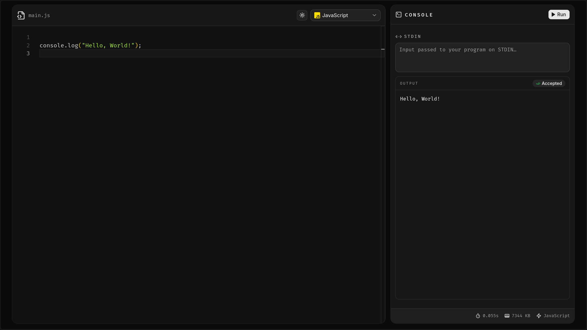

# Online Code Editor

A browser-based code editor for writing and running code in JavaScript, Python, Java, C, and C++ without installing anything locally.

**Live demo:** https://my-online-code-editor.vercel.app/



## Features

- Monaco Editor with syntax highlighting, ligatures, and word wrap
- Five languages: JavaScript, Python, Java, C, and C++
- Language-specific starter snippets and file names
- Run code directly from the browser and view stdout, stderr, and compile errors
- Pass input to programs through a dedicated stdin panel
- Execution status badges for accepted runs, compilation errors, runtime errors, time limits, and memory limits
- Execution time and memory usage reported after each run
- Light and dark themes
- Language selector with version information

## Tech Stack

- React 18
- Vite
- Tailwind CSS v4
- Monaco Editor via `@monaco-editor/react`
- shadcn/ui components built on Base UI
- Judge0 API for code execution

## Getting Started

### Prerequisites

- Node.js 18 or newer
- npm

### Installation

```bash
git clone https://github.com/aakash-rajbhar/Online-Code-Editor.git
cd Online-Code-Editor
npm install
```

### Development

```bash
npm run dev
```

Open the URL printed by Vite, typically http://localhost:5173.

### Build

```bash
npm run build
npm run preview
```

### Lint

```bash
npm run lint
```

## Usage

1. Pick a language from the selector in the editor header.
2. Write or edit the code in the editor.
3. Add any program input to the stdin field in the console panel.
4. Press Run to execute the code.
5. Review the output, status, execution time, and memory usage.

## Project Structure

```text
public/
  preview.png           README preview image
src/
  api.js                Judge0 submission client
  constants.js          Languages, versions, snippets, and file names
  App.jsx               App shell and theme state
  components/
    CodeEditor.jsx      Editor layout and language handling
    LanguageSelector.jsx
    Output.jsx          stdin, run controls, and execution results
    monacoTheme.js
    ui/                 shadcn/ui components
  assets/               Language icons
```

## Code Execution

Code is submitted to the public Judge0 endpoint at `ce.judge0.com` with `wait=true`, so results are returned in the same request. Language IDs and versions are defined in `src/constants.js`.

The execution service is shared and rate limited. For production or heavy use, host your own Judge0 instance and update the `baseURL` in `src/api.js`.

## Deployment

The app is deployed on Vercel: https://my-online-code-editor.vercel.app/

To deploy your own copy, import the repository into Vercel and keep the default build settings for Vite:

- Build command: `npm run build`
- Output directory: `dist`
